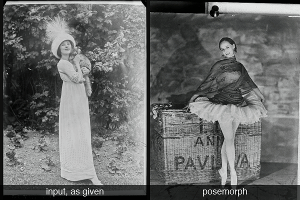
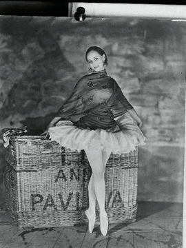
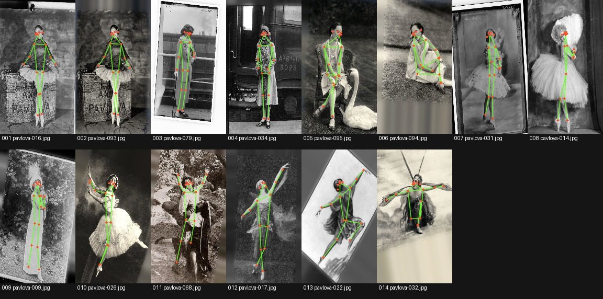

# posemorph

**Turn a pile of pictures of one person into a video where they seem to move.**

Give posemorph a folder of photos, paintings or statues of the same figure.
It finds the body in each picture, puts the head and torso in the same place
on screen, sorts the pictures so that similar poses sit next to each other,
and renders a video: quick cuts, or a morph that bends one pose into the next.

<p align="center">
  
</p>

*Left: 14 public-domain photos of the ballerina Anna Pavlova (1881–1931), as given.
Right: the same photos after `posemorph run`. Her head and torso stay put, and
standing, seated and dancing poses are grouped. Sources: [CREDITS](docs/assets/CREDITS.md).*

<table>
<tr>
<td align="center" width="38%"><br><sub><code>--mode morph</code>: landmark-driven warps between poses</sub></td>
<td align="center"><br><sub><code>contact-sheet.jpg</code>: what was detected, and the order chosen</sub></td>
</tr>
</table>

Status: early release (0.1.0). Runs on a CPU (Apple Silicon included), no GPU
or PyTorch needed. Licensed under [Apache-2.0](LICENSE).

## How it works

| Step | What happens | Written to |
| --- | --- | --- |
| 1. **detect** | Find people (YOLOX) and 17 body keypoints for each (RTMPose): eyes, nose, shoulders, hips, wrists… | `detect.json` |
| 2. **select** | Drop pictures where the head, both shoulders or both hips aren't seen clearly | `select.json` |
| 3. **align** | Rotate, scale and crop each picture so the head and torso land on the same spot of the frame | `align.json`, `aligned/` |
| 4. **order** | Compare poses (after removing position, size and rotation) and find a short path through them, so each picture is followed by a similar pose | `order.json` |
| 5. **render** | Cut video, or morph video that warps one picture into the next along the moving keypoints | `cut.mp4` / `morph.mp4` |
| 6. **report** | Contact sheet with skeletons, rejection counts, and how much smoother the order is than a random one | `report.json`, `contact-sheet.jpg` |

In the demo above, the average pose jump between consecutive pictures dropped
from 0.87 (random order) to 0.52.

## Install

Python **3.12+** and FFmpeg with `libx264` are required.

```sh
brew install ffmpeg            # or your platform's FFmpeg with libx264
pip install "posemorph @ git+https://github.com/kmsk99/posemorph@v0.1.0"
```

The wheel is also attached to the
[GitHub release](https://github.com/kmsk99/posemorph/releases/tag/v0.1.0).
The first run downloads the YOLOX-s and RTMPose-m weights (Apache-2.0, about
85 MB) to `~/.cache/posemorph`; later runs reuse them. See
[model licenses](docs/models.md).

For development:

```sh
git clone https://github.com/kmsk99/posemorph && cd posemorph
uv venv --python 3.12 && source .venv/bin/activate
uv pip install -e '.[dev]'
```

## Quick start

```sh
# Everything in one go: detect → select → align → order → cut video
posemorph run ./photos --out ./out/demo --size 1080x1920 --fps 30 \
  --alignment head-torso --mirror auto --mode cut --hold 6

# Reuse the same analysis for a morph video
posemorph render --out ./out/demo --mode morph --hold 2 --transition 4

# Rebuild the contact sheet and report
posemorph report --out ./out/demo
```

Open `out/demo/contact-sheet.jpg` first: it shows which body was detected in
each picture and the order chosen. If the wrong person was picked in a group
photo, choose another one with `--person-overrides` (see the
[usage reference](docs/usage.md#choosing-a-person-and-importing-poses)).

Useful options:

| Option | Effect |
| --- | --- |
| `--alignment head-torso` | Pin the face as well as the torso; less head wobble between cuts |
| `--mirror auto` | Flip pictures that face the other way so the motion reads in one direction |
| `--order phase` | Order by arm movement (raise → peak → strike) instead of shortest path |
| `--mode morph` | Warp between pictures instead of cutting |
| `--duration 30 --speed-curve '0:.25,1:.1'` | Fit a length; start slow, speed up |
| `--audio music.wav` | Add a soundtrack; cuts can snap to its beats |
| `--zoom 1:1.12`, `--normalize-tone` | Slow camera push-in; even out brightness between pictures |
| `--relevance-prompts prompts.json` | Optional SigLIP2 filter that drops off-topic pictures (needs `.[relevance]`) |

Every stage can also be run on its own (`posemorph detect|select|align|order|render|report`);
changing an earlier stage tells you which later ones to rerun. Run
`posemorph COMMAND --help` for all flags.

## Learn more

- [Usage reference](docs/usage.md): every option, the stage files, choosing a
  person, importing your own poses, relevance filtering and the experimental
  art-domain pose backend.
- [Model and dependency licenses](docs/models.md).
- [Validation notes](docs/validation.md): measurements from a 233-artwork run.

## Limitations

- The pose model is trained on photos. Paintings, statues, costumes, wings and
  heavy occlusion can confuse it; a confident skeleton may still belong to the
  wrong figure. Check the contact sheet.
- Alignment matches head and torso, not every limb. Very different viewpoints
  or proportions still jump, and pictures smaller than the frame are extended
  with blurred edges.
- Morphs warp the whole picture, background included. Ghosting, folds and
  rubbery faces can appear; there is no depth or person mask.
- Ordering is a heuristic meant for tens to hundreds of pictures. Static
  pictures don't reveal motion direction, so the order is a plausible guess.
- Colors are treated as sRGB; output is H.264 BT.709 SDR.

## Checks

```sh
uv pip install -e '.[dev]'
pytest -q                    # synthetic fixtures only, no network
pytest -q --run-model        # also download/use real weights
ruff check src tests
```

## License

Copyright 2026 kmsk99. posemorph is licensed under the
[Apache License, Version 2.0](LICENSE). The license covers this code only;
model weights downloaded at runtime keep their own terms (see
[docs/models.md](docs/models.md)), and it grants no rights to your input images.
The demo images are public domain; see [CREDITS](docs/assets/CREDITS.md).
